# AI-Based Agricultural Commodity Arrival Analysis, Market Supply Forecasting, and Optimization System

## Machine Learning | Artificial Immune System (AIS) | Particle Swarm Optimization (PSO)

An intelligent agricultural market analysis and commodity arrival prediction system developed using **Python, Machine Learning, Deep Learning, Artificial Immune System (AIS), and Particle Swarm Optimization (PSO)**.

The project analyzes historical agricultural commodity arrival records from Meghalaya, India, to identify market supply patterns, estimate commodity arrival quantities, evaluate agricultural market activity, and compare conventional machine learning models with optimization-based approaches.

The system integrates data preprocessing, exploratory data analysis, predictive modeling, hyperparameter optimization, model evaluation, and graphical visualization.

---

## 1. Project Overview

Agricultural commodity markets play an important role in the distribution of agricultural products and the functioning of regional food supply chains.

Variations in commodity arrivals across markets can affect storage requirements, transportation planning, market infrastructure, and agricultural supply management.

Traditional market analysis often relies on manual examination of historical records, which can make it difficult to identify patterns across different commodities, districts, blocks, and markets.

This project proposes an **AI-Based Agricultural Commodity Arrival Analysis System** that uses historical agricultural market data to estimate commodity arrival quantities and analyze supply patterns.

The system uses several machine learning algorithms to model the relationship between agricultural commodity arrivals and market-related features.

Additionally, two nature-inspired optimization algorithms are implemented:

1. **Artificial Immune System (AIS)** using the Clonal Selection Algorithm.
2. **Particle Swarm Optimization (PSO)** using swarm intelligence.

Both algorithms optimize Random Forest hyperparameters to investigate whether optimization improves predictive performance.

The project produces trained models, prediction datasets, evaluation reports, and graphical visualizations.

---

## 2. Problem Statement

Agricultural markets experience variations in commodity arrivals due to differences in location, agricultural production, seasonal conditions, and market activity.

Analyzing these variations using historical records can support agricultural market monitoring and supply planning.

However, conventional statistical analysis may not capture complex relationships between commodities, markets, districts, and arrival quantities.

The main problem addressed by this project is:

**How can machine learning and nature-inspired optimization algorithms be used to analyze agricultural commodity arrival patterns and improve the estimation of market supply quantities?**

The proposed system addresses this problem by:

- Processing historical agricultural market data.
- Identifying commodity arrival patterns.
- Comparing agricultural markets.
- Predicting commodity arrival quantities.
- Evaluating multiple machine learning algorithms.
- Optimizing Random Forest hyperparameters using AIS.
- Optimizing Random Forest hyperparameters using PSO.
- Comparing baseline, AIS, and PSO model performance.
- Generating graphical reports and prediction datasets.

---

## 3. Project Objectives

The primary objectives of this project are:

### 3.1 Agricultural Commodity Analysis

Analyze historical commodity arrival records to identify agricultural supply patterns.

### 3.2 Market Performance Assessment

Compare commodity arrival quantities across districts, blocks, and agricultural markets.

### 3.3 Commodity Arrival Prediction

Develop regression models to estimate commodity arrival quantities using historical market-related features.

### 3.4 Machine Learning Model Comparison

Compare different regression algorithms using standard performance evaluation metrics.

### 3.5 AIS-Based Optimization

Implement an Artificial Immune System using clonal selection to optimize Random Forest hyperparameters.

### 3.6 PSO-Based Optimization

Implement Particle Swarm Optimization to identify improved Random Forest configurations.

### 3.7 Performance Evaluation

Evaluate predictive models using:

- Mean Absolute Error (MAE)
- Root Mean Squared Error (RMSE)
- R² Score

### 3.8 Agricultural Supply Insights

Generate data-driven insights that may support market monitoring, storage planning, and agricultural supply assessment.

---

## 4. Dataset Description

### Dataset Name

`megamb_data_for_2012_n.xls`

### Dataset Domain

Agricultural Commodity Market Arrivals

### Geographical Coverage

Meghalaya, India

### Data Source

Historical agricultural commodity arrival records supplied for this project.

### Dataset Attributes

| Attribute | Description |
|-----------|-------------|
| District | District containing the agricultural market |
| Block | Administrative block |
| Market | Name of the agricultural market |
| Year | Year of observation |
| Month | Month of observation |
| Commodity | Agricultural commodity name |
| Arrival | Recorded commodity arrival quantity |
| Unit | Measurement unit |

### Target Variable

`Arrival`

The target represents the quantity of an agricultural commodity arriving at a particular market.

The recorded arrival quantity is measured in **quintals**.

### Input Features

The machine learning models use:

- District
- Block
- Market
- Year
- Month
- Commodity

### Example Agricultural Commodities

The dataset includes agricultural products such as:

- Arecanut
- Banana
- Cabbage
- Carrot
- Cauliflower
- Ginger
- Potato
- Rice

### Prediction Task

The project is formulated as a **supervised regression problem**.

Given the district, block, market, year, month, and commodity, the system estimates the corresponding commodity arrival quantity.

---

## 5. Technologies Used

### Programming Language

- Python

### Data Processing

- Pandas
- NumPy
- xlrd

### Machine Learning

- Scikit-learn

### Deep Learning

- TensorFlow
- Keras

### Optimization Algorithms

- Artificial Immune System (AIS)
- Clonal Selection Algorithm (CLONALG)
- Particle Swarm Optimization (PSO)

### Data Visualization

- Matplotlib
- Seaborn

### Model Serialization

- Joblib
- Pickle
- HDF5

### Configuration and Metadata

- YAML
- JSON

### Development Environment

- Visual Studio Code
- Jupyter Notebook
- Python Command Prompt

---

## 6. Proposed System Architecture

The system follows a structured machine learning pipeline.

```text
                Agricultural Market Dataset
                            |
                            v
                    Data Collection
                            |
                            v
                    Data Preprocessing
                            |
             +--------------+--------------+
             |              |              |
             v              v              v
       Missing Values   Data Encoding   Data Cleaning
             |              |              |
             +--------------+--------------+
                            |
                            v
                  Feature Engineering
                            |
                            v
                    Train-Test Split
                            |
              +-------------+-------------+
              |             |             |
              v             v             v
          Baseline ML      AIS           PSO
              |             |             |
              v             v             v
         ML Training   Clonal Selection  Swarm Search
              |             |             |
              |             v             v
              |        Optimized RF   Optimized RF
              |             |             |
              +-------------+-------------+
                            |
                            v
                     Model Evaluation
                            |
                            v
                  Performance Comparison
                            |
                            v
                  Arrival Prediction
                            |
                            v
                   Result Visualization
                            |
                            v
                 Model and Report Storage
```

---

## 7. Data Preprocessing

Data preprocessing is performed before training the machine learning models.

### 7.1 Dataset Loading

The dataset is loaded using Pandas.

```python
import pandas as pd

df = pd.read_excel(
    "megamb_data_for_2012_n.xls",
    engine="xlrd"
)
```

### 7.2 Missing Value Handling

Missing categorical values are handled using imputation.

Records with missing target values are removed.

### 7.3 Duplicate Removal

Duplicate records are removed to reduce redundant observations.

### 7.4 Data Type Conversion

Numerical columns such as `Year` and `Arrival` are converted to numeric data types.

### 7.5 Categorical Encoding

Categorical variables are transformed using One-Hot Encoding.

```python
OneHotEncoder(
    handle_unknown="ignore",
    sparse_output=False
)
```

### 7.6 Numerical Scaling

Numerical features are standardized using StandardScaler.

### 7.7 Target Transformation

The arrival quantity is transformed using:

```python
y_log = np.log1p(y)
```

This transformation can reduce the influence of highly skewed arrival quantities.

Predictions are converted back to the original arrival scale using:

```python
prediction = np.expm1(prediction_log)
```

### 7.8 Dataset Splitting

The dataset is divided into:

- Training data: 80%
- Testing data: 20%

A fixed random seed of 42 is used for reproducibility.

The test dataset is kept separate from model optimization.

---

## 8. Machine Learning Models

The project implements multiple regression algorithms.

### 8.1 Ridge Regression

Ridge Regression is used as a linear baseline model.

It introduces regularization to reduce excessive model complexity.

### 8.2 Decision Tree-Based Random Forest

Random Forest combines predictions from multiple decision trees.

It can capture nonlinear relationships between agricultural market features and commodity arrival quantities.

### 8.3 Gradient Boosting Regressor

Gradient Boosting builds models sequentially to reduce prediction errors.

It is useful for learning complex relationships in structured datasets.

### 8.4 Extra Trees Regressor

Extra Trees uses randomized decision tree construction to generate ensemble predictions.

### 8.5 Artificial Neural Network

A feedforward neural network is implemented using TensorFlow and Keras.

The network contains:

- Input layer
- Dense hidden layers
- ReLU activation functions
- Dropout regularization
- Output layer with linear activation

The neural network is trained using the Adam optimizer and mean squared error loss.

---

## 9. Artificial Immune System (AIS)

### 9.1 Introduction

Artificial Immune System is a nature-inspired optimization approach based on biological immune system mechanisms.

The project implements a Clonal Selection Algorithm to optimize Random Forest hyperparameters.

### 9.2 AIS Working Principle

The algorithm follows these steps:

1. Initialize a population of antibodies.
2. Represent Random Forest hyperparameters as antibodies.
3. Evaluate each antibody using cross-validation.
4. Select high-performing antibodies.
5. Clone selected antibodies.
6. Apply mutations to cloned antibodies.
7. Introduce new random antibodies.
8. Retain promising candidates.
9. Repeat the optimization process.
10. Train the final Random Forest using the selected parameters.

### 9.3 Antibody Representation

Each antibody represents:

```text
[n_estimators,
 max_depth,
 min_samples_split,
 min_samples_leaf,
 max_features]
```

### 9.4 AIS Configuration

| Parameter | Value |
|-----------|-------|
| Population Size | 8 |
| Generations | 8 |
| Top Antibodies | 4 |
| Clones per Antibody | 3 |
| New Random Antibodies | 2 |
| Cross-Validation Folds | 3 |

### 9.5 AIS Fitness Function

The fitness function minimizes cross-validated RMSE calculated in log-transformed target space.

Lower fitness values indicate better validation performance.

### 9.6 AIS Output

The optimization produces:

- Best Random Forest hyperparameters
- Optimized regression model
- Cross-validation fitness history
- Test-set evaluation metrics
- Prediction CSV files
- Comparison graphs
- Convergence graph

---

## 10. Particle Swarm Optimization (PSO)

### 10.1 Introduction

Particle Swarm Optimization is a population-based optimization algorithm inspired by collective behavior in biological swarms.

In this project, PSO optimizes Random Forest hyperparameters.

### 10.2 PSO Working Principle

The optimization process includes:

1. Initialize particle positions.
2. Initialize particle velocities.
3. Evaluate particle fitness.
4. Store personal-best positions.
5. Identify the global-best position.
6. Update particle velocities.
7. Update particle positions.
8. Recalculate fitness.
9. Repeat until the iteration limit is reached.
10. Train the final optimized model.

### 10.3 Particle Representation

Each particle represents:

```text
[n_estimators,
 max_depth,
 min_samples_split,
 min_samples_leaf,
 max_features]
```

### 10.4 PSO Configuration

| Parameter | Value |
|-----------|-------|
| Number of Particles | 8 |
| Number of Iterations | 10 |
| Inertia Weight | 0.7 |
| Cognitive Coefficient | 1.5 |
| Social Coefficient | 1.5 |
| Cross-Validation Folds | 3 |

### 10.5 Velocity Update Equation

The particle velocity is updated using:

\[
v_i^{t+1} =
wv_i^t +
c_1r_1(pbest_i-x_i^t) +
c_2r_2(gbest-x_i^t)
\]

Where:

- \(v_i\): Particle velocity
- \(x_i\): Particle position
- \(w\): Inertia weight
- \(c_1\): Cognitive coefficient
- \(c_2\): Social coefficient
- \(r_1,r_2\): Random values
- \(pbest\): Personal-best position
- \(gbest\): Global-best position

### 10.6 Position Update Equation

\[
x_i^{t+1}=x_i^t+v_i^{t+1}
\]

### 10.7 PSO Output

The algorithm generates:

- Optimized Random Forest model
- Best particle parameters
- Optimization history
- Convergence visualization
- Model evaluation metrics
- Prediction datasets
- Baseline vs AIS vs PSO comparison

---

## 11. Model Evaluation Metrics

The project evaluates regression models using three metrics.

### 11.1 Mean Absolute Error (MAE)

MAE measures the average absolute difference between actual and predicted values.

\[
MAE=\frac{1}{n}\sum_{i=1}^{n}|y_i-\hat{y}_i|
\]

A lower MAE indicates better prediction performance.

### 11.2 Root Mean Squared Error (RMSE)

RMSE measures the square root of the average squared prediction error.

\[
RMSE=\sqrt{\frac{1}{n}\sum_{i=1}^{n}(y_i-\hat{y}_i)^2}
\]

Lower RMSE values indicate smaller prediction errors.

### 11.3 R² Score

R² measures how well the regression model explains variation in the target variable.

\[
R^2=1-
\frac{\sum(y_i-\hat{y}_i)^2}
{\sum(y_i-\bar{y})^2}
\]

A higher R² score generally indicates better model performance.

R² can be negative when a model performs worse than predicting the test-set mean.

---

## 12. Results and Visualization

The system automatically generates graphical outputs to support model evaluation and agricultural market analysis.

### 12.1 Main Model Accuracy Visualization

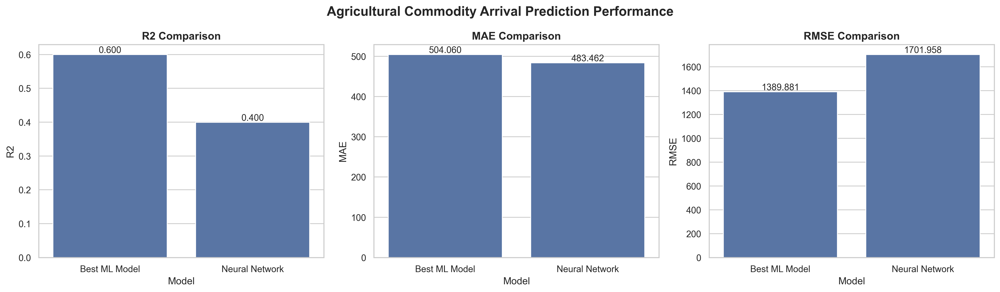

**Figure 1: Machine Learning and Deep Learning Model Performance Comparison**

The accuracy graph displays:

- R² Score
- Mean Absolute Error
- Root Mean Squared Error

It compares the baseline machine learning model and neural network.

The figure is generated automatically by:

```python
python agricultural_visualization.py
```

The graph provides a visual comparison of predictive performance on held-out test records.

### 12.2 Agricultural Commodity Heatmap

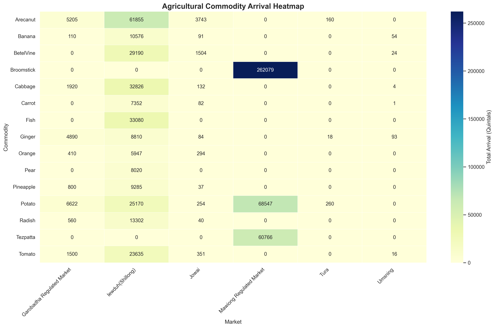

The heatmap displays commodity arrival quantities across agricultural markets.

It helps identify:

- High-arrival commodities
- Low-arrival commodities
- Markets with larger recorded arrival volumes
- Differences in agricultural market activity

### 12.3 Machine Learning Model Comparison

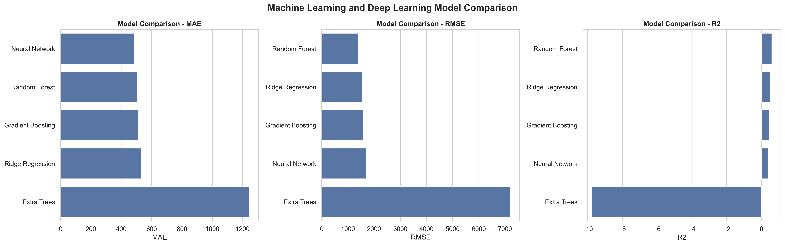

This graph compares the regression performance of the trained baseline models.

### 12.4 Actual vs Predicted Results

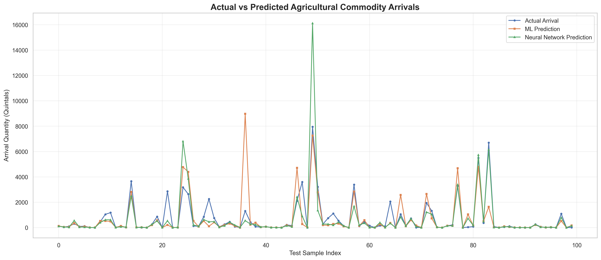

This graph compares actual commodity arrival quantities against predictions generated by machine learning and neural network models.

### 12.5 Commodity-Wise Prediction Graph

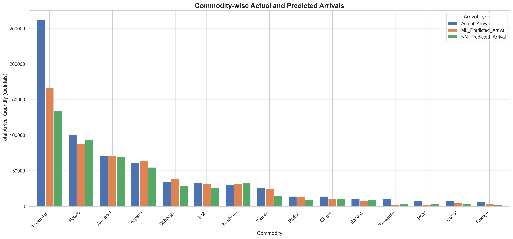

This graph compares aggregated actual and predicted arrivals for selected agricultural commodities.

---

## 13. AIS Optimization Results

### 13.1 AIS Performance


Displays the performance of the AIS-optimized Random Forest model.

### 13.2 AIS Model Comparison

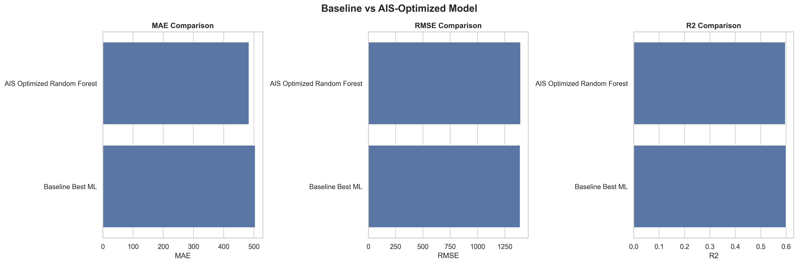

Compares AIS optimization against the baseline machine learning model when the baseline model is available.

### 13.3 AIS Optimization Convergence

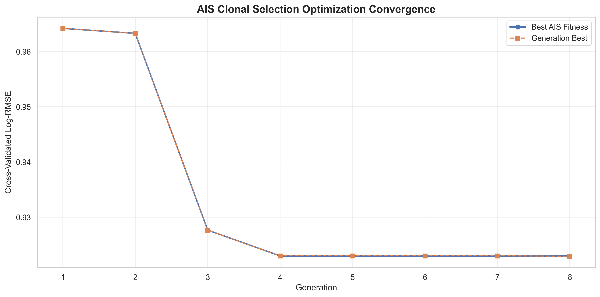

Displays the best fitness score across AIS generations.

### 13.4 AIS Prediction Results

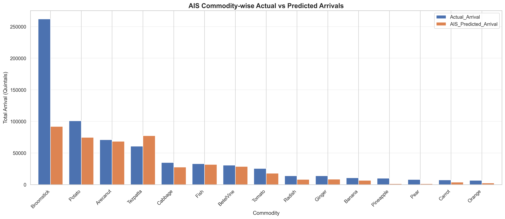

Displays commodity-wise arrival estimates generated by the AIS-optimized model.

### 13.5 AIS Actual vs Predicted

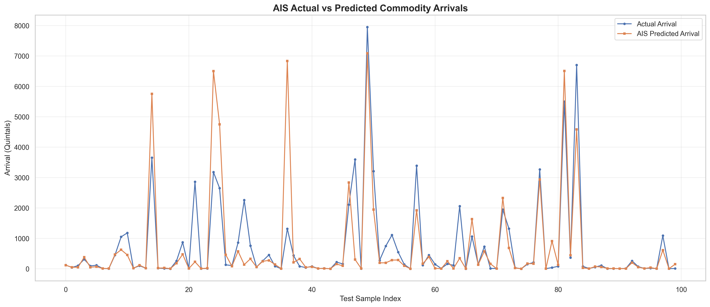

Compares held-out actual arrival quantities against AIS model predictions.

---

## 14. PSO Optimization Results

### 14.1 PSO Performance

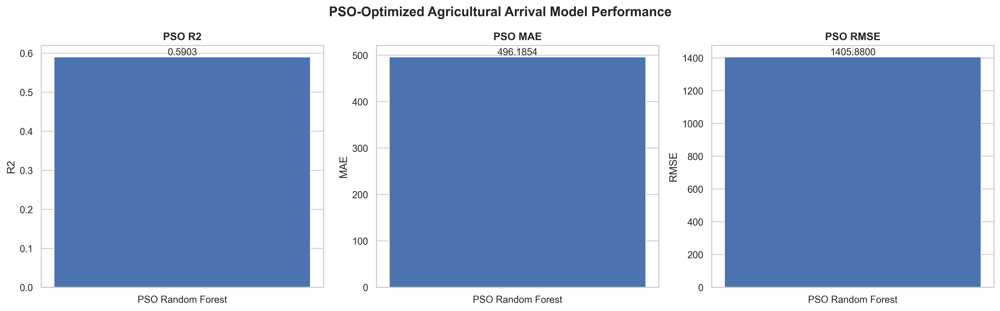

Displays the evaluation metrics of the PSO-optimized Random Forest.

### 14.2 PSO Model Comparison

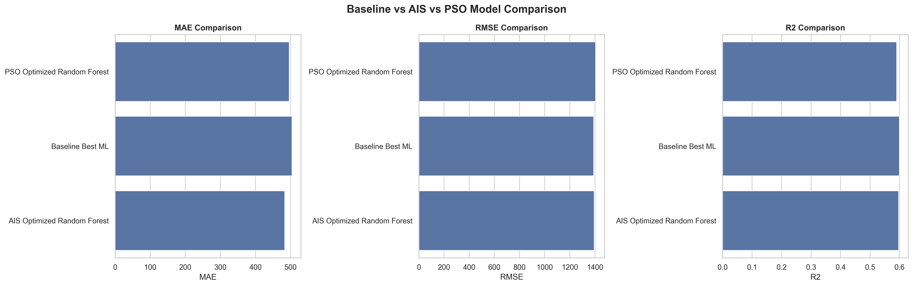

Compares baseline, AIS, and PSO models when their saved model files are available.

### 14.3 PSO Optimization Convergence

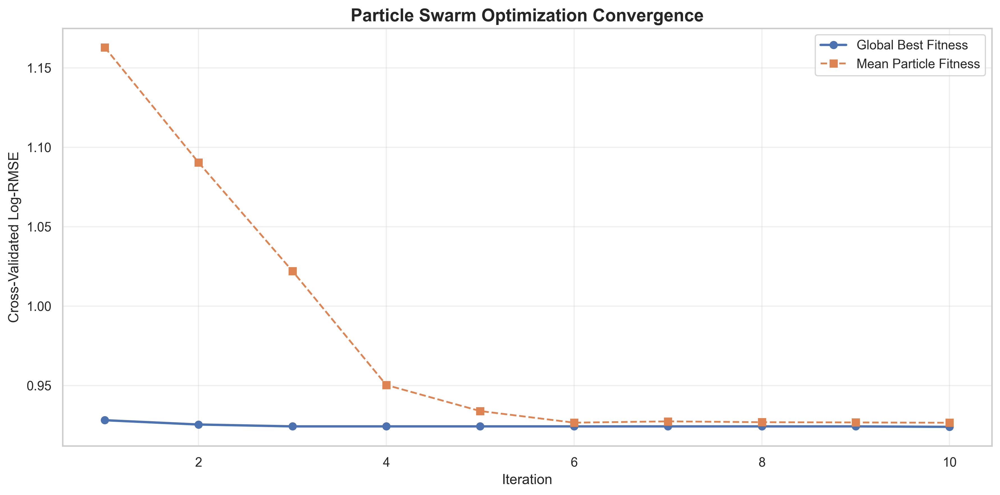

Shows the global-best and average particle fitness values across iterations.

### 14.4 PSO Prediction Results

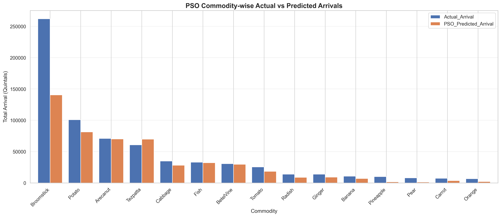

Displays commodity-wise actual and PSO-predicted arrival quantities.

### 14.5 PSO Actual vs Predicted

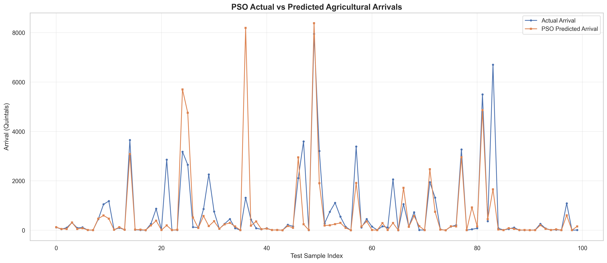

Compares actual arrival quantities against PSO predictions on the held-out test dataset.

---

## 15. Project Directory Structure

```text
AI-Based Agricultural Commodity Arrival Analysis/
│
├── megamb_data_for_2012_n.xls
│
├── train_agricultural_model.py
├── agricultural_visualization.py
├── ais_agricultural_analysis.py
├── pso_agricultural_analysis.py
│
├── agricultural_model.h5
├── agricultural_model.pkl
├── preprocessor.pkl
├── config.yaml
├── model_metadata.json
│
├── cleaned_dataset.csv
├── commodity_summary.csv
├── market_summary.csv
├── model_comparison.csv
├── test_predictions.csv
├── training_history.csv
│
├── accuracy_graph.png
├── heatmap.png
├── comparison_graph.png
├── result.csv
├── result_graph.png
├── prediction.csv
├── prediction_graph.png
├── evaluation_metrics.csv
│
├── ais_agricultural_model.pkl
├── ais_config.yaml
├── ais_model_metadata.json
├── ais_cleaned_dataset.csv
├── ais_evaluation_metrics.csv
├── ais_comparison.csv
├── ais_result.csv
├── ais_prediction.csv
├── ais_optimization_history.csv
│
├── ais_accuracy_graph.png
├── ais_heatmap.png
├── ais_comparison_graph.png
├── ais_result_graph.png
├── ais_prediction_graph.png
├── ais_optimization_graph.png
│
├── pso_agricultural_model.pkl
├── pso_config.yaml
├── pso_model_metadata.json
├── pso_cleaned_dataset.csv
├── pso_evaluation_metrics.csv
├── pso_comparison.csv
├── pso_result.csv
├── pso_prediction.csv
├── pso_optimization_history.csv
│
├── pso_accuracy_graph.png
├── pso_heatmap.png
├── pso_comparison_graph.png
├── pso_result_graph.png
├── pso_prediction_graph.png
├── pso_optimization_graph.png
│
└── README.md
```

---

## 16. Installation and Setup

### Step 1: Install Python

Install a compatible version of Python and configure the Python environment.

TensorFlow availability depends on the Python version and operating system.

### Step 2: Install Dependencies

Run:

```bash
python -m pip install pandas numpy matplotlib seaborn scikit-learn tensorflow joblib pyyaml xlrd
```

### Step 3: Download or Prepare Dataset

Place the dataset inside the project directory:

```text
megamb_data_for_2012_n.xls
```

### Step 4: Configure Dataset Path

Set the project directory in each Python script:

```python
PROJECT_DIR = Path(
    r"C:\Users\sagni\Downloads\AI-Based Agricultural Commodity Arrival Analysis"
)
```

### Step 5: Train Baseline Models

```bash
python train_agricultural_model.py
```

This generates the baseline machine learning and neural network models.

### Step 6: Generate Baseline Visualizations

```bash
python agricultural_visualization.py
```

This generates the baseline graphs, prediction CSV, and result CSV.

### Step 7: Run AIS Optimization

```bash
python ais_agricultural_analysis.py
```

This performs clonal selection optimization and generates AIS-prefixed outputs.

### Step 8: Run PSO Optimization

```bash
python pso_agricultural_analysis.py
```

This performs Particle Swarm Optimization and generates PSO-prefixed outputs.

---

## 17. Model Prediction Example

The trained machine learning model can estimate commodity arrival quantities for a supplied market record.

```python
import joblib
import pandas as pd
import numpy as np

model = joblib.load(
    "agricultural_model.pkl"
)

sample = pd.DataFrame([{
    "District": "East Khasi Hills",
    "Block": "Mylliem",
    "Market": "Iewduh(Shillong)",
    "Month": "Jan",
    "Commodity": "Potato",
    "Year": 2012
}])

prediction_log = model.predict(sample)

prediction = np.maximum(
    np.expm1(prediction_log),
    0
)

print(
    "Predicted Arrival:",
    prediction[0],
    "Quintals"
)
```

The result is an estimated arrival quantity for the supplied combination of features.

Prediction reliability depends on the quality and coverage of the training dataset.

---

## 18. Model Comparison Methodology

The project compares three main approaches.

| Approach | Method |
|----------|--------|
| Baseline ML | Conventional regression algorithms |
| AIS Optimization | Clonal Selection-based Random Forest tuning |
| PSO Optimization | Particle Swarm-based Random Forest tuning |

The comparison considers:

- MAE
- RMSE
- R² Score
- Cross-validation performance
- Optimization convergence
- Model complexity

AIS and PSO optimize Random Forest hyperparameters using cross-validation on the training data.

The final models are evaluated using the held-out test dataset.

The optimization methods do not guarantee better performance than the baseline.

Actual improvements must be established using the generated evaluation results.

---

## 19. Prediction and Result Files

### 19.1 Baseline Results

`result.csv`

Contains:

- District
- Block
- Market
- Month
- Commodity
- Year
- Actual Arrival
- ML Predicted Arrival
- Neural Network Predicted Arrival
- Absolute Errors
- Squared Errors

### 19.2 Baseline Predictions

`prediction.csv`

Contains fitted-model predictions for all valid dataset records.

### 19.3 AIS Results

`ais_result.csv`

Contains actual and AIS-predicted arrival quantities for held-out test records.

### 19.4 AIS Predictions

`ais_prediction.csv`

Contains AIS model estimates for all dataset records.

### 19.5 PSO Results

`pso_result.csv`

Contains actual and PSO-predicted arrival quantities for held-out test records.

### 19.6 PSO Predictions

`pso_prediction.csv`

Contains PSO model estimates for all dataset records.

**Important:** Prediction files containing training records should not be used as independent evidence of predictive accuracy.

The held-out result files should be used for model evaluation.

---

## 20. Applications

### Agricultural Market Monitoring

The system can help examine commodity arrival patterns across different markets.

### Commodity Supply Assessment

Historical arrival analysis can help identify commodities with relatively high or low recorded supply.

### Market Infrastructure Planning

Arrival patterns may provide supporting information for market infrastructure and storage planning.

### Agricultural Data Analytics

The project demonstrates how machine learning can be applied to structured agricultural market datasets.

### Predictive Modeling Research

The system provides a framework for comparing conventional machine learning against AIS- and PSO-optimized regression models.

### Academic Research

The project can support studies involving:

- Agricultural analytics
- Machine learning regression
- Nature-inspired optimization
- Hyperparameter tuning
- Model evaluation
- Agricultural market information systems

---

## 21. Advantages

The proposed system provides several advantages:

1. Automated agricultural market data processing.
2. Commodity-wise arrival analysis.
3. Market-wise supply comparisons.
4. Multiple regression model implementations.
5. AIS-based hyperparameter optimization.
6. PSO-based hyperparameter optimization.
7. Automated performance evaluation.
8. Graphical representation of results.
9. Exportable CSV prediction datasets.
10. Reusable trained machine learning models.
11. Structured YAML configuration.
12. JSON-based model metadata.

---

## 22. Limitations

### Historical Data Availability

The project uses historical agricultural commodity arrival records.

If the dataset contains only observations from 2012, the models cannot establish reliable future-year forecasting accuracy.

### Limited Predictive Features

The current implementation uses:

- District
- Block
- Market
- Year
- Month
- Commodity

Additional variables such as rainfall, crop production, commodity prices, transportation conditions, and market demand may improve predictive performance.

### Random Train-Test Splitting

The implementation uses a random 80/20 train-test split.

This evaluates performance on held-out records but does not simulate a chronological forecasting scenario.

### Model Generalization

Prediction performance may decline for markets, commodities, or periods that are poorly represented in the training data.

### Optimization Cost

AIS and PSO require repeated model training and cross-validation, increasing computational requirements.

### Distribution Optimization

The current implementation optimizes prediction-model hyperparameters.

It does not directly optimize transportation routes, storage allocation, or agricultural commodity distribution.

Such applications would require additional operational datasets and optimization constraints.

---

## 23. Future Enhancements

Future versions of the system can include:

### 23.1 Multi-Year Forecasting

Integrate agricultural market records from multiple years to support temporal forecasting.

### 23.2 Weather-Based Prediction

Include rainfall, temperature, humidity, and seasonal conditions.

### 23.3 Agricultural Price Analysis

Integrate market price data to study relationships between commodity arrivals and prices.

### 23.4 Advanced Deep Learning

Explore:

- Long Short-Term Memory (LSTM)
- Gated Recurrent Unit (GRU)
- Temporal Convolutional Networks
- Transformer-based forecasting

### 23.5 Hybrid AIS-PSO Optimization

Develop a hybrid optimization approach combining clonal selection and swarm intelligence.

### 23.6 Web Dashboard

Build an interactive dashboard using:

- Streamlit
- Flask
- FastAPI
- Plotly

### 23.7 Market Supply Forecasting

Use multi-year records to estimate future commodity arrival quantities.

### 23.8 Distribution Optimization

Integrate transportation costs, storage capacities, commodity demand, and geographic distances to support agricultural distribution optimization.

### 23.9 Explainable AI

Use SHAP or permutation importance to interpret the influence of different market features on model predictions.

### 23.10 Real-Time Data Integration

Integrate periodically updated agricultural market data to support ongoing monitoring and model retraining.

---

## 24. Research Significance

This project demonstrates the integration of machine learning and nature-inspired optimization techniques for agricultural market data analysis.

Its primary research contribution is the implementation and comparison of three modeling approaches:

1. Conventional machine learning regression.
2. AIS-optimized Random Forest regression.
3. PSO-optimized Random Forest regression.

The project provides a reproducible experimental workflow for examining whether population-based optimization algorithms improve Random Forest hyperparameter selection.

The generated evaluation metrics and convergence histories can be used to analyze the relative performance of these approaches.

The system also demonstrates the use of structured agricultural records for market-level commodity arrival estimation.

---

## 25. Expected Outcomes

After successful execution, the system is expected to produce:

- Cleaned agricultural market dataset.
- Commodity arrival summaries.
- Market arrival summaries.
- Trained machine learning models.
- Trained neural network model.
- AIS-optimized Random Forest model.
- PSO-optimized Random Forest model.
- Model comparison reports.
- Regression evaluation metrics.
- Actual vs predicted arrival datasets.
- Commodity-wise prediction visualizations.
- Agricultural market heatmaps.
- AIS optimization convergence graph.
- PSO optimization convergence graph.
- YAML configuration files.
- JSON metadata files.

The numerical results depend on the dataset and trained model performance.

No particular prediction accuracy or optimization improvement is guaranteed.

---

## 26. Conclusion

The **AI-Based Agricultural Commodity Arrival Analysis, Market Supply Forecasting, and Optimization System** presents a machine learning framework for analyzing agricultural commodity arrivals across markets in Meghalaya, India.

The system combines conventional regression algorithms, deep learning, Artificial Immune System optimization, and Particle Swarm Optimization to estimate commodity arrival quantities and evaluate predictive performance.

Through preprocessing, model training, hyperparameter optimization, evaluation, and visualization, the project provides a structured approach to agricultural market analytics.

The implementation demonstrates how nature-inspired optimization algorithms can be integrated with machine learning models for systematic hyperparameter search.

The resulting models and reports may support agricultural market analysis and provide a foundation for more advanced forecasting and distribution planning systems.

---

## 27. Project Information

**Project Title:** AI-Based Agricultural Commodity Arrival Analysis, Market Supply Forecasting, and Optimization System

**Domain:** Artificial Intelligence, Machine Learning, Agricultural Analytics

**Programming Language:** Python

**Machine Learning Framework:** Scikit-learn

**Deep Learning Framework:** TensorFlow/Keras

**Optimization Algorithms:** Artificial Immune System (AIS), Particle Swarm Optimization (PSO)

**Dataset:** Meghalaya Agricultural Commodity Arrival Data (2012)

**Target Variable:** Agricultural Commodity Arrival Quantity

**Evaluation Metrics:** MAE, RMSE, R² Score

**Project Type:** Machine Learning and Optimization-Based Agricultural Analytics System

---

## 28. License

This project is intended for educational, academic, and research purposes.

Dataset usage and redistribution must follow the terms specified by the original data provider.

A separate software license may be added by the project author.

---

## 29. Acknowledgment

This project uses historical agricultural market data for the development and evaluation of machine learning-based commodity arrival prediction models.

The implementation uses open-source Python libraries, including Pandas, NumPy, Scikit-learn, TensorFlow, Matplotlib, and Seaborn.

The AIS and PSO implementations demonstrate the application of nature-inspired computational intelligence techniques to regression model optimization.

---

**AI-Based Agricultural Commodity Arrival Analysis**

*Machine Learning | Deep Learning | Artificial Immune System | Particle Swarm Optimization | Agricultural Analytics*
